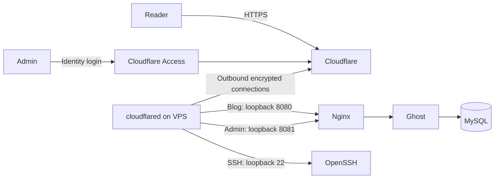

# Ghost on Hetzner through Cloudflare Tunnel

One command provisions a new Hetzner Cloud VPS and deploys Ghost. The server has no public inbound application ports, including SSH. Bootstrap uses cloud-init, so there is no temporary SSH exception.

```bash
./infra/ghost/deploy.sh
```

This creates billable Hetzner resources. It assumes a new deployment, an existing Cloudflare-managed domain, and an existing Cloudflare Zero Trust organization. It does not take over an existing VPS or DNS records.

## Architecture



- A deny-inbound Hetzner firewall is supplied in the server creation request. Both public IPv4 and IPv6 remain assigned for outbound connectivity, but no inbound allow rules exist.
- `cloudflared` runs on the host, connects outbound, and forwards to loopback listeners. Egress remains permitted, including Cloudflare TCP/UDP 7844, DNS, and package/image downloads.
- The blog is public. The admin and SSH hostnames require the configured email through Cloudflare Access. The connector also validates Access JWTs before forwarding these requests.
- SSH requires the administrator's private key after Access authentication. Root login, password login, keyboard-interactive login, and public SSH listeners are disabled. Ubuntu's SSH socket activation is disabled explicitly.
- Nginx normalizes request paths, blocks public Ghost administration/setup routes, and supplies HTTPS proxy headers. The public Content API remains available with Ghost's own API-key authentication, preserving native search and integrations.
- Ghost and MySQL have persistent Docker volumes. MySQL has no published port and uses an internal Docker network. Images are pinned by digest; `cloudflared` is pinned by version and SHA-256.
- This is a single-server deployment, without high availability. Losing Cloudflare connectivity temporarily removes both blog access and tunneled administration.

## Prerequisites

Use macOS or Linux with Bash, Python 3.9+, and [Terraform](https://developer.hashicorp.com/terraform/install) 1.9+ (validated with 1.17.1). Provider versions and checksums are committed. Windows users can use WSL2. The deployment machine does not need Docker or a direct network route to the VPS.

Prepare:

1. A Hetzner Cloud project and a read/write API token. The default is `cx23` in `fsn1`; the selected server type must be x86 with at least 4 GB RAM. Capacity and quotas are ultimately checked by Hetzner during creation.
2. An active DNS zone on Cloudflare. Use three unused single-label subdomains, for example `blog.example.com`, `ghost-admin.example.com`, and `ghost-ssh.example.com`. Single-level names avoid additional wildcard certificate requirements.
3. A Cloudflare Zero Trust organization, its team name from `TEAM.cloudflareaccess.com`, and a working login method. One-time PIN is sufficient for setup; an identity provider enforcing MFA is suitable for ongoing administration. The allowed email must be able to authenticate through that method.
4. A Cloudflare API token scoped to the selected account/zone with these permissions:

   | Scope | Permission |
   | --- | --- |
   | Account | Cloudflare Tunnel: Edit |
   | Account | Access: Apps and Policies: Edit |
   | Account | Access: Organizations, Identity Providers, and Groups: Read |
   | Zone | Zone: Read |
   | Zone | DNS: Edit |

5. An Ed25519 SSH public key. Only the public key is uploaded. To create a dedicated key:

   ```bash
   ssh-keygen -t ed25519 -f ~/.ssh/ghost_hetzner
   ```

Install [client-side cloudflared](https://developers.cloudflare.com/cloudflare-one/networks/connectors/cloudflare-tunnel/use-cases/ssh/ssh-cloudflared-authentication/) on machines that will use SSH. It is not required to run the deployment command.

## Deploy

```bash
cp infra/ghost/config.example.tfvars.json infra/ghost/config.tfvars.json
chmod 600 infra/ghost/config.tfvars.json
```

Fill in all placeholders. `access_team_name` is only the team name, without `.cloudflareaccess.com`. Set `ssh_public_key` to the complete contents of your `.pub` file.

Provide the API tokens as environment variables. For example, in Bash, paste each token after its `read` command; input is hidden and is not part of shell history:

```bash
read -rs HCLOUD_TOKEN
export HCLOUD_TOKEN
read -rs CLOUDFLARE_API_TOKEN
export CLOUDFLARE_API_TOKEN
./infra/ghost/deploy.sh
```

To inspect the plan without creating infrastructure:

```bash
./infra/ghost/deploy.sh --plan
```

An optional configuration argument is resolved relative to `infra/ghost/`; an absolute path also works. Configuration is JSON, never sourced as shell code.

The script verifies account/zone ownership, Access configuration, DNS ownership, and server requirements. Terraform creates the tunnel, Access policies, DNS, firewall, SSH key, and server. Cloud-init installs and starts the runtime. The script then waits up to approximately 15 minutes for HTTPS and tunnel readiness, checks Access redirects and public admin-route blocking, checks the applied provider firewall, and probes public application ports. An unavailable local IPv6 route is reported explicitly.

On success, open the printed admin URL, authenticate through Access, and complete Ghost's owner setup. Ghost owner credentials are separate from Cloudflare Access. The setup endpoint is protected before the VPS starts.

API authorization, quota, capacity, DNS propagation, certificate issuance, package mirrors, and image registries can still fail. A failure returns a nonzero exit code and retains resources and state for diagnosis; it never deletes a partially configured server automatically.

## Email and feature scope

For transactional email, add an `smtp` object to the configuration before deployment:

```json
{
  "smtp": {
    "host": "smtp.example.com",
    "port": 587,
    "secure": false,
    "user": "smtp-user",
    "password": "REPLACE_WITH_SMTP_PASSWORD",
    "from": "Blog <blog@example.com>"
  }
}
```

This is an additional field in the existing configuration, not a replacement file. Use `secure: true` for implicit TLS on port 465. Without SMTP, publishing works but password reset, staff verification emails, and member email flows are not configured. Configure mail for a usable ongoing production publication. Bulk newsletters require Ghost's supported newsletter provider separately. Self-hosted ActivityPub and analytics are outside this core-blog deployment.

## SSH and recovery

```sshconfig
Host ghost-blog
    HostName ghost-ssh.example.com
    User ghostadmin
    IdentityFile ~/.ssh/ghost_hetzner
    IdentitiesOnly yes
    ProxyCommand cloudflared access ssh --hostname %h
```

```bash
ssh ghost-blog
sudo cloud-init status --long
sudo systemctl status ghost cloudflared ssh
sudo journalctl -u cloudflared -u ghost --since '30 minutes ago'
sudo tail -n 100 /var/log/cloud-init-output.log
sudo ss -lntp
sudo docker compose --project-directory /opt/ghost ps
```

Keep SSH host-key verification enabled. Compare the first-use fingerprint with `ssh-keygen -lf /etc/ssh/ssh_host_ed25519_key.pub` in the Hetzner web console if needed.

If the tunnel never starts, use the Hetzner web console. If necessary, reset the root password through Hetzner's control panel/API to log in through the console; this does not enable root SSH or open the firewall. Inspect the bootstrap log and repair the failing dependency, then run `sudo bash /opt/ghost/bootstrap.sh`. The bootstrap preserves existing database credentials and data. After recovery, lock the temporary root password with `passwd -l root`. Do not enable public SSH or boot a network rescue environment for this workflow.

Cloud-init runs on first boot only. Re-running `deploy.sh` reconciles infrastructure and checks readiness; it does not automatically rerun failed cloud-init. An unchanged successful deployment should produce no Terraform changes. DNS ownership checks use resource state, including state from an interrupted apply.

## State, secrets, and updates

Treat this directory's local Terraform state as a secret and back it up securely. It contains the tunnel token and any supplied SMTP configuration. `sensitive` hides normal CLI output; it does not encrypt state. State, plans, real configuration, and temporary deployment files are ignored by Git. The wrapper creates private files and removes temporary plans on exit. API tokens stay on the deployment machine; only the scoped tunnel token reaches the VPS.

Database passwords are generated on the server and retained across bootstrap retries. `/opt/ghost/.env` is root-readable; Ghost's JSON configuration is readable by its container user. The connector receives its root-owned token through systemd credentials rather than a token in its command line. Root and Docker administrators can access runtime secrets.

The tunnel token and optional SMTP credentials also exist in Hetzner's cloud-init user data and the server's root-owned cloud-init files. A Docker systemd drop-in blocks forwarded container traffic to the metadata IP before each daemon start, using the `DOCKER-USER` chain. Keep the Ubuntu package's default iptables backend; switching Docker to its experimental nftables backend requires translating this rule. This does not restrict trusted host administrators.

Keep the original provisioning configuration and state together. The server has Terraform `prevent_destroy` plus Hetzner delete/rebuild protection. The wrapper additionally rejects all planned deletions and replacements. Changing cloud-init inputs, including the SSH key or bootstrap files, can require replacement and is intentionally blocked; it is not an in-place configuration-management system.

For an in-place Ghost upgrade, take and verify a backup, check Ghost's supported upgrade path, copy an explicitly pinned updated Compose file to `/opt/ghost/` through the tunnel, then run:

```bash
sudo -i
cd /opt/ghost
docker compose pull
docker compose up -d --wait --wait-timeout 300
```

Retain the prior image digests and the corresponding backup. Database migrations can make a simple image downgrade unsafe; restore matching data when rolling back. Apply operating-system security updates and schedule reboots through the tunnel. Do not use unattended container image upgrades.

## Backups and restore

```bash
ssh ghost-blog 'sudo bash /opt/ghost/backup.sh'
```

The script pauses Ghost, dumps MySQL, copies content and runtime configuration, and restarts Ghost even if the backup fails. This produces a consistent archive in `/var/backups/ghost/`, with private permissions. Backups contain credentials. Copy each archive off the VPS, encrypt it, and apply a retention policy; a backup on the same disk does not protect against VPS loss. For example, substitute the printed filename:

```bash
umask 077
ssh ghost-blog 'sudo cat /var/backups/ghost/ghost-TIMESTAMP.tar.gz' > ghost-backup.tar.gz
```

For a restore drill, use a disposable deployment and a trusted backup. Extract into a root-only directory such as `/root/ghost-restore`. With its current stack running, stop Ghost, import the dump using the target database credentials, copy the content, fix ownership, and restart:

```bash
sudo -i
cd /opt/ghost
docker compose stop ghost
docker compose exec -T db sh -c 'export MYSQL_PWD="$MYSQL_ROOT_PASSWORD"; exec mysql --user=root ghost' < /root/ghost-restore/ghost.sql
docker compose cp /root/ghost-restore/content/. ghost:/var/lib/ghost/content
docker compose run --rm --no-deps --user root --entrypoint chown ghost -R 1000:1000 /var/lib/ghost/content
docker compose up -d --wait --wait-timeout 300
```

Use a clean target for the restore so old uploads/themes are not retained. Preserve the target `.env` and database credentials; copying old credentials over an already initialized database will not change its users. Reapply the backed-up site/mail settings deliberately, preserving the target domain and database connection. Verify a post, an uploaded image, admin login, and email delivery before switching traffic. Hetzner snapshots alone are not a verified database/content backup.

## Verification

Checks without provider credentials or a VPS:

```bash
cd infra/ghost
terraform init -backend=false -input=false -lockfile=readonly
terraform fmt -check -recursive
terraform validate
terraform test
python3 -m unittest discover -s tests -v
bash -n deploy.sh bootstrap.sh backup.sh tests/smoke.sh
shellcheck deploy.sh bootstrap.sh backup.sh tests/smoke.sh
```

Terraform tests use mock providers. They check creation-time firewall attachment, access policies, JWT enforcement, bootstrap limits, loopback publication, input validation, and safe secret serialization. Python tests exercise destructive-plan rejection, partial-apply DNS ownership, credential redirects, readiness failures, and public-port checks.

On a Linux x86 host with Docker Compose v2 and ports 8080/8081 free, run:

```bash
bash tests/smoke.sh
```

This starts the pinned stack in an isolated Compose project, checks Ghost, attempts encoded/case-varied admin paths, checks Content API authentication, and verifies database/content persistence across container recreation. It deletes only its own test project's volumes on exit. The scoped GitHub Actions workflow runs these checks without cloud credentials.

A real deployment must additionally verify successful and rejected Access identities, SSH key rejection/acceptance, host reboot recovery, external IPv4/IPv6 scans, transactional mail, and backup restoration. Mock tests and container tests do not establish these provider-level outcomes.

## Intentional teardown

After exporting and verifying your data, explicitly remove `prevent_destroy` and disable both Hetzner protection flags in `main.tf`. Apply those protection changes, then run `terraform destroy -var-file=config.tfvars.json` directly. `deploy.sh` deliberately refuses destruction. Destroying the server deletes its local Docker volumes. Do not delete Terraform state to resolve a failed deployment; that loses resource ownership without removing billable resources.

## Design references

- [Hetzner firewall behavior](https://docs.hetzner.com/cloud/firewalls/faq/).
- [Docker's user firewall chain](https://docs.docker.com/engine/network/firewall-iptables/).
- [Cloudflare SSH through a tunnel](https://developers.cloudflare.com/cloudflare-one/networks/connectors/cloudflare-tunnel/use-cases/ssh/ssh-cloudflared-authentication/).
- [Cloudflare Terraform resources](https://developers.cloudflare.com/tunnel/guides/terraform/).
- [Ghost production hosting](https://docs.ghost.org/hosting/).
- Ghost's Compose configuration was inspected at [`af0fcad`](https://github.com/TryGhost/ghost-docker/blob/af0fcad04ef1e4c6b7582ddc36696be5138820b2/compose.yml). This package adapts the core Ghost/MySQL pattern for tunnel-only ingress.
- Hetzner creation-time firewall and cloud-init replacement behavior was checked in [`internal/server/resource.go` and its tests at `06cf2c1`](https://github.com/hetznercloud/terraform-provider-hcloud/tree/06cf2c1271a4c98a850626165ca4925793a3f229/internal/server).
- Cloudflare provider contracts and Access application tests were inspected at release [`v5.28.1`, commit `9b51a58`](https://github.com/cloudflare/terraform-provider-cloudflare/tree/9b51a582458f5c5d46d8547ed2604fcba91fb861/internal/services/zero_trust_access_application).
